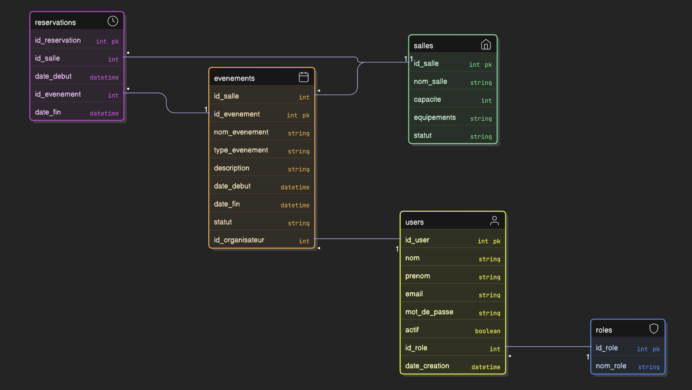

# Module de réservation

### Prérequis

- Node.js 18+
- Base de donnée MYSQL
- Une connection à la base de donnée (`db.js`)
- Ces tables ci doivent exister:
  - `reservations`
  - `salles`
  - `evenements`
- Un fichier `.env` contenant:
  - PORT
  - DB_HOST
  - DB_USER
  - DB_PASSWORD
  - DB_NAME

### Diagramme de classe pour ce module

### Permet de gérer les opérations liés à la réservation:

1. Ajouter une réservation
2. Mettre à jour une réservation
3. Supprimer une réservation
4. Récupérer les réservations par ID ou par salle
