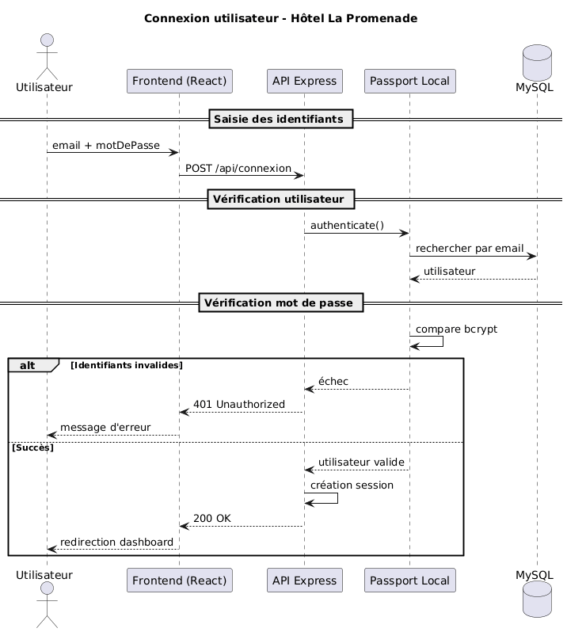

# Module d’authentification

### Prérequis

- Node.js 18+
- Base de donnée MySQL
- Configuration de la base (`db.js`) fonctionnelle
- Passport.js configuré (`auth.js`)
- Sessions Express configurées (`express-session` + store)
- Un fichier `.env` contenant :
  - PORT
  - DB_HOST
  - DB_USER
  - DB_PASSWORD
  - DB_NAME
  - SESSION_SECRET

### Tables requises

- `users` (au minimum) :
  - `id_user` (PK)
  - `nom`
  - `prenom`
  - `email` (unique)
  - `mot_de_passe` (hash bcrypt)
  - `actif` (0/1)
  - `id_role` (FK vers roles)
  - `date_creation` (DEFAULT CURRENT_TIMESTAMP conseillé)
- `roles` :
  - `id_role` (PK)
  - `nom_role` (ex: Administrateur, Organisateur, Coordonnateur, Comptabilité)

### Objectif du module

Permet de :

1. Ajouter (créer) un utilisateur (seulemrnt ceux qui ont le roles (1) Admin)
2. Connecter un utilisateur (création de session)
3. Connaître l’utilisateur connecté (route /me)
4. Déconnecter un utilisateur (suppression session)

### Sécurité / Sessions

- L’authentification utilise **Passport Local Strategy**
- Les mots de passe sont stockés **hachés** (bcrypt)
- La session est maintenue par un **cookie de session**
- Le frontend doit envoyer les cookies :
  - `credentials: 'include'` côté fetch
- En développement (Vite 5173 + API 5000), utiliser :
  - soit un **proxy Vite**
  - soit CORS `origin: http://localhost:5173` + `credentials: true`

---

## Endpoints API

### 1) Ajout de L'utilisateur

**POST** `/api/admin/users`

**But :**
Créer un utilisateur dans la base.

**Body JSON (exemple) :**

```json
{
  "nom": "roger",
  "prenom": "Du_tro=chet",
  "email": "roger@test.com",
  "motDePasse": "12345678",
  "role": "Organisateur"
}
```

**Règles :**

- email valide

- motDePasse >= 8 caractères

- role optionnel

- si non fourni → rôle par défaut : Organisateur

- seul un utilisateur avec rôle Admin (id_role=1) peut créer un utilisateur:

- 201 Created → utilisateur créé

- 409 Conflict → email déjà utilisé

- 400 Bad Request → données invalides

- 500 Internal Server Error → erreur serveur

### 2) Connexion

**POST** `/api/connexion`

**But :**
Vérifier identifiants et créer une session.

**Body JSON (exemple) :**

```json
{
  "email": "franck@test.com",
  "motDePasse": "12345678"
}
```

**Réponses :**

- 200 OK → connexion réussie + cookie session

- 401 Unauthorized → mauvais utilisateur / mauvais mot de passe

- 403 Forbidden → utilisateur désactivé (si tu gères actif=0)

- 500 Internal Server Error → erreur serveur

### 3) Deconnexion

**POST** `/api/deconnexion`
**But :**
Terminer la session de l’utilisateur connecté.
**Réponses :**

- 200 OK → déconnexion réussie
- 401 Unauthorized → pas d’utilisateur connecté
- 500 Internal Server Error → erreur serveur

### 4) diagramme de séquence (connexion)


