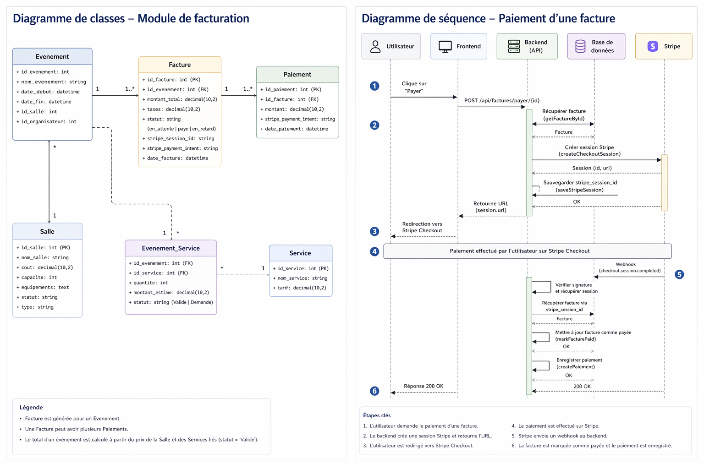

# Module de facturation

## Prérequis

- Node.js 18+
- Base de données MySQL
- Une connexion à la base (db.js)
- Compte Stripe (mode test recommandé)

## Diagramme de classe pour ce module



### Tables requises

- factures
- paiements
- evenements
- salles
- evenement_services

### Ajout dans le fichier .env

- STRIPE_SECRET_KEY
- STRIPE_PUBLISHABLE_KEY
- STRIPE_WEBHOOK_SECRET

Voici un example:

```env
STRIPE_SECRET_KEY=sk_test_51TJle69...
STRIPE_PUBLISHABLE_KEY=pk_test_51TJle69...
STRIPE_WEBHOOK_SECRET=whsec_fc545c1...
```

### Installation des dépendances

```bash
npm install express mysql2 stripe dotenv
```

### Configuration Stripe

1. Créer un compte sur Stripe
2. Aller dans Developers → API keys
3. Copier la clé secrète (sk*test*...)
4. Ajouter dans .env

Webhook

1. Aller dans Developers → Webhooks
2. Appuyez sur `Set up local listener` et suivez les instructions.
   Depuis un nouveau PowerShell / CMD(Windows) ou zsh(Mac):

```bash
- cd /Backend
- stripe login
- stripe listen --forward-to localhost:5001/api/factures/webhook
```

3. Copier le Signing secret → .env

## Flux de facturation

1. Un événement est validé

- Une facture est créée automatiquement
- Le total est calculé (salle + services validés)

2. L’utilisateur clique sur "payer"

- Redirection vers Stripe Checkout

3.  Paiement réussi

- Webhook Stripe déclenché
- Facture marquée comme payée
- Paiement enregistré

## Logique métier

Calcul du total

- Salle : prix fixe (s.cout)
- Services :
  - total = somme(quantite × montant_estime)
- Total final :
  - total = salle + services
  - taxes = total × 0.13

## Routes API

**Base URL:** `http://localhost:5001/api/factures`

### 1. Créer une facture

**POST** `/create/:id_evenement`

#### - Crée une facture automatiquement pour un événement.

#### Response

201 - Succès

```json
{
  "id_facture": 5
}
```

404

```json
{
  "error": "Événement introuvable"
}
```

### 2. Obtenir toutes les factures

**GET** `/`

#### - Met à jour les factures en retard (>30 jours)

#### - Retourne toutes les factures

#### Response

```json
[
  {
    "id_facture": 1,
    "montant_total": 200,
    "taxes": 26,
    "statut": "en_attente",
    "nom_evenement": "Event Test"
  }
]
```

### 3. Obtenir une facture par ID

**GET** `/:id`

#### Response

```json
{
  "id_facture": 1,
  "montant_total": 200,
  "taxes": 26,
  "statut": "paye",
  "nom_evenement": "Event Test"
}
```

### 4. Rechercher des factures

**GET** `/search`

#### Query params

| Paramètre    | Description             |
| ------------ | ----------------------- |
| id_evenement | Filtrer par événement   |
| date_debut   | Date minimum            |
| date_fin     | Date maximum            |
| statut       | en_attente / paye / etc |

#### Exemple

```
/api/factures/search?id_evenement=1&statut=paye
```

### 5. Payer une facture

**POST** `/payer/:id`

#### - Crée une session Stripe

#### - Sauvegarde stripe_session_id

#### - Retourne une URL de paiement

#### Response

```json
{
  "url": "https://checkout.stripe.com/..."
}
```

### 6. Webhook Stripe

**POST** `/webhook`

#### Stripe appelle automatiquement cette route après paiement.

#### Actions effectuées

- Vérifie la signature Stripe
- Récupère la facture via session.id
- Vérifie si déjà payée
- Met à jour :
  - statut → paye
  - stripe_payment_intent → sauvegardé
- Crée un enregistrement dans paiements

## Structure des données

### Table `factures`

| Champ                 | Description                |
| --------------------- | -------------------------- |
| id_facture            | ID                         |
| id_evenement          | FK événement               |
| montant_total         | Montant HT                 |
| taxes                 | Taxes                      |
| statut                | en_attente / paye / retard |
| stripe_session_id     | ID session Stripe          |
| stripe_payment_intent | ID paiement Stripe         |
| date_facture          | Date création              |

### Table `paiements`

| Champ                 | Description  |
| --------------------- | ------------ |
| id_paiement           | ID           |
| id_facture            | FK facture   |
| montant               | Montant payé |
| stripe_payment_intent | ID Stripe    |

### Fonctions principales (modèle)

#### createFacture

Crée une facture

#### getFactureById

Retourne une facture + événement

#### getAllFactures

Retourne toutes les factures

#### saveStripeSession

Associe session Stripe

#### markFacturePaid

Passe facture à paye

#### createPaiement

Enregistre paiement

#### calculateEventTotal

Calcule total événement

## Exemple de test Stripe (mode test)

Carte de test :

```
4242 4242 4242 4242
Date: 12/34
CVC: 123
```
