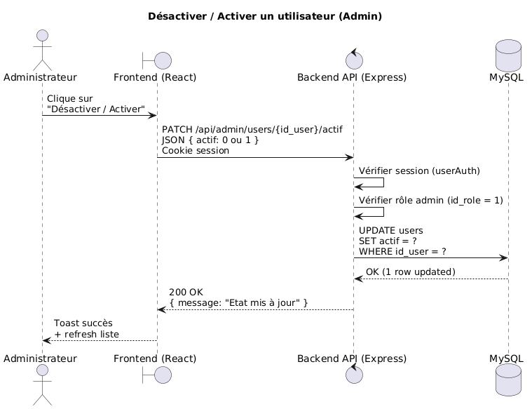

# Module : Gestion des utilisateurs & rôles

Ce document décrit la fonctionnalité **Gestion des utilisateurs** et **Gestion des rôles** pour la plateforme de gestion des événements de **l’Hôtel La Promenade**.

---

## Prérequis

- Node.js 18+
- Base de données MySQL
- Configuration DB fonctionnelle (`db/db.js`)
- Authentification & sessions fonctionnelles (voir `Authentification.md`) :
  - Passport.js configuré (`auth.js`)
  - `express-session` + store (`memorystore`)
- Un fichier `.env` contenant au minimum :
  - `PORT`
  - `DB_HOST`
  - `DB_USER`
  - `DB_PASSWORD`
  - `DB_NAME`
  - `SESSION_SECRET`

---

## Tables requises

### Table `roles`

- `id_role` (PK)
- `nom_role` (ex : Administrateur, Organisateur, Coordonnateur, Comptabilité)

> Remarque : dans notre projet, les rôles sont **fixes** (4 rôles). On ne gère pas la création/suppression de rôles via l’UI dans le Sprint 1, uniquement l’attribution.

### Table `users`

- `id_user` (PK)
- `nom`
- `prenom`
- `email` (unique)
- `mot_de_passe` (hash bcrypt)
- `actif` (0/1)
- `id_role` (FK vers `roles.id_role`)
- `date_creation` (**DEFAULT CURRENT_TIMESTAMP** conseillé)

---

## Objectif du module

Permet à un **Administrateur (id_role = 1)** de :

1. **Créer** un compte utilisateur (US-002)
2. **Lister** tous les utilisateurs (avec rôle + date d’inscription)
3. **Modifier** les informations d’un utilisateur (nom, prénom, email)
4. **Modifier le rôle** d’un utilisateur (US-003)
5. **Désactiver / réactiver** un utilisateur (empêche la connexion si inactif)
6. **Supprimer** un utilisateur (si nécessaire)

---

## Sécurité / Autorisations

- Toutes les routes **Admin** doivent être protégées par :
  - `userAuth` (utilisateur connecté)
  - `roleAuth([1])` ou `adminOnly` (uniquement Administrateur)
- Les opérations doivent retourner :
  - **401 Unauthorized** si non connecté
  - **403 Forbidden** si connecté mais pas Admin

---

## Règles métier (important)

- **Email** doit être valide et **unique**
- **Mot de passe** : minimum 8 caractères (à la création)
- Lors d’une modification :
  - le mot de passe n’est **pas modifié** sauf si une route dédiée est prévue
- Si `actif = 0` :
  - l’utilisateur ne peut pas se connecter
  - retour API conseillé : **403 Forbidden** (ou 401, selon votre logique)
- Historique des modifications :
  - (Sprint suivant) on pourra ajouter une table `audit_logs` pour conserver l’historique

---

# Endpoints API (Admin)

> Base des routes : `/api/admin/...`

## 1) Lister les utilisateurs

**GET** `/api/admin/users`

**But :**
Retourner la liste complète des utilisateurs avec leurs informations principales.

**Réponse 200 (exemple) :**
```json
[
  {
    "id_user": 1,
    "nom": "Kamdem",
    "prenom": "Franck",
    "email": "franck@test.com",
    "id_role": 1,
    "nom_role": "Administrateur",
    "actif": 1,
    "date_creation": "2026-02-27T01:35:12.000Z"
  }
]
```

**Réponses :**
- 200 OK
- 401 Unauthorized
- 403 Forbidden
- 500 Internal Server Error

---

## 2) Créer un utilisateur (Admin)

**POST** `/api/admin/users`

**But :**
Créer un nouvel utilisateur (compte employé).

**Body JSON (exemple) :**
```json
{
  "nom": "Roger",
  "prenom": "Dupont",
  "email": "roger@test.com",
  "motDePasse": "12345678",
  "id_role": 2
}
```

**Règles :**
- `nom`, `prenom` requis
- `email` valide
- `motDePasse` >= 8 caractères
- `id_role` optionnel :
  - si non fourni → par défaut **Organisateur (2)**

**Réponses :**
- 201 Created → utilisateur créé
- 400 Bad Request → données invalides
- 409 Conflict → email déjà utilisé
- 401 Unauthorized
- 403 Forbidden
- 500 Internal Server Error

---

## 3) Modifier un utilisateur (infos)

**PATCH** `/api/admin/users/:id_user`

**But :**
Modifier les champs d’identité de l’utilisateur (et éventuellement le rôle si vous le permettez dans la même route).

**Body JSON (exemple) :**
```json
{
  "nom": "Roger",
  "prenom": "Dupond",
  "email": "roger@test.com",
  "id_role": 3
}
```

**Réponses :**
- 200 OK
- 400 Bad Request
- 409 Conflict → email déjà utilisé
- 401 Unauthorized
- 403 Forbidden
- 404 Not Found → utilisateur introuvable
- 500 Internal Server Error

---

## 4) Modifier le rôle d’un utilisateur

Deux options possibles (choisir une seule stratégie) :

### Option A (route dédiée)

**PATCH** `/api/admin/users/:id_user/role`

**Body JSON :**
```json
{ "id_role": 4 }
```

### Option B (dans la route de modification)

**PATCH** `/api/admin/users/:id_user` avec `id_role`

**Réponses :**
- 200 OK
- 400 Bad Request
- 401 Unauthorized
- 403 Forbidden
- 404 Not Found
- 500 Internal Server Error

---

## 5) Désactiver / Réactiver un utilisateur

**PATCH** `/api/admin/users/:id_user/actif`

**Body JSON (exemple) :**
```json
{ "actif": 0 }
```

**But :**
- `actif = 0` → désactivation
- `actif = 1` → réactivation

**Réponses :**
- 200 OK
- 400 Bad Request
- 401 Unauthorized
- 403 Forbidden
- 404 Not Found
- 500 Internal Server Error

---

## 6) Supprimer un utilisateur

**DELETE** `/api/admin/users/:id_user`

**But :**
Supprimer un compte utilisateur.

**Réponses :**
- 200 OK (ou 204 No Content)
- 401 Unauthorized
- 403 Forbidden
- 404 Not Found
- 500 Internal Server Error

---

# UI (Frontend React) — Sprint 1

## Page : Admin > Utilisateurs

Fonctions attendues :
- Formulaire de création d’utilisateur (nom, prénom, email, mot de passe, rôle)
- Tableau listant :
  - nom, prénom, email
  - rôle (select)
  - date d’inscription
  - actif (oui/non)
  - actions : **Modifier / Désactiver / Supprimer**
- Feedback utilisateur via **toast** :
  - erreurs en rouge
  - succès en bleu

---

## Diagramme de séquence (gestion utilisateur — exemple “Désactiver”)



