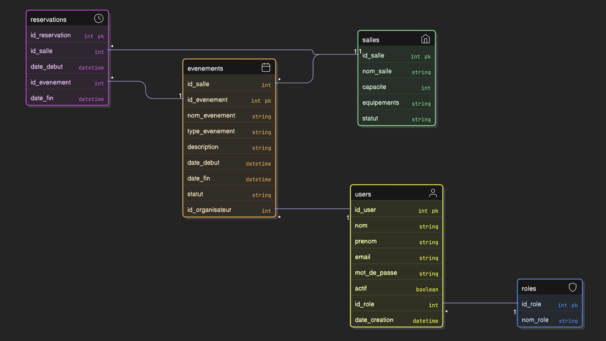

# Module de réservation

## Prérequis

- Node.js 18+
- Base de données MySQL
- Une connexion à la base de données (`db.js`)
- Ces tables doivent exister:
  - `reservations`
  - `salles`
  - `evenements`
- Un fichier `.env` contenant:
  - `PORT`
  - `DB_HOST`
  - `DB_USER`
  - `DB_PASSWORD`
  - `DB_NAME`

## Diagramme de classe pour ce module



## Gestion des conflits

- La détection des conflits de date utilise:
  `date_debut < new_end AND date_fin > new_start`
- Toutes les dates sont au format MySQL `DATETIME`
- Les salles avec le statut "Indisponible" ne peuvent pas être réservées

---

## API – Routes disponibles

### Routes Réservation

#### 1. Créer une réservation

**POST** `/api/reservation`

Crée une nouvelle réservation après vérification des conflits et de la disponibilité de la salle.

##### Body (JSON)

```json
{
  "idSalle": 1,
  "idEvenement": 2,
  "dateDebut": "2026-02-20 10:00:00",
  "dateFin": "2026-02-20 12:00:00"
}
```

##### Réponses

**201 – Créé**

```json
{
  "idReservation": 15
}
```

**400 – Salle indisponible**

```json
{
  "error": "Salle indisponible"
}
```

**409 – Conflit de réservation**

```json
{
  "error": "Conflit de réservation"
}
```

**500 – Erreur serveur**

```json
{
  "error": "Erreur serveur"
}
```

---

#### 2. Obtenir les réservations d'une salle

**GET** `/api/reservation/salle/:idSalle`

Retourne toutes les réservations pour une salle spécifique avec les informations de l'événement associé.

##### Paramètres

| Nom     | Type   | Description    |
| ------- | ------ | -------------- |
| idSalle | number | ID de la salle |

##### Réponse

**200 – Succès**

```json
[
  {
    "id_reservation": 15,
    "id_salle": 1,
    "id_evenement": 2,
    "nom_evenement": "Réunion Q1",
    "date_debut": "2026-02-20T10:00:00.000Z",
    "date_fin": "2026-02-20T12:00:00.000Z",
    "description": "Réunion trimestrielle"
  }
]
```

**500 – Erreur serveur**

```json
{
  "error": "Erreur serveur"
}
```

---

#### 3. Obtenir une réservation par ID

**GET** `/api/reservation/:id`

Retourne une réservation spécifique.

##### Paramètres

| Nom | Type   | Description          |
| --- | ------ | -------------------- |
| id  | number | ID de la réservation |

##### Réponses

**200 – Succès**

```json
{
  "id_reservation": 15,
  "id_salle": 1,
  "id_evenement": 2,
  "date_debut": "2026-02-20T10:00:00.000Z",
  "date_fin": "2026-02-20T12:00:00.000Z"
}
```

**404 – Introuvable**

```json
{
  "error": "Réservation introuvable"
}
```

**500 – Erreur serveur**

```json
{
  "error": "Erreur serveur"
}
```

---

#### 4. Supprimer une réservation

**DELETE** `/api/reservation/:id`

Supprime une réservation existante.

##### Paramètres

| Nom | Type   | Description          |
| --- | ------ | -------------------- |
| id  | number | ID de la réservation |

##### Réponses

**204 – Succès** (pas de contenu)

**404 – Introuvable**

```json
{
  "error": "Réservation introuvable"
}
```

**500 – Erreur serveur**

```json
{
  "error": "Erreur serveur"
}
```

---

### Routes Salles

#### 5. Obtenir toutes les salles

**GET** `/api/salles`

Retourne la liste de toutes les salles avec leurs informations.

##### Réponse

**200 – Succès**

```json
[
  {
    "id_salle": 1,
    "nom_salle": "Salle Versailles",
    "capacite": 100,
    "equipements": "Projecteur, Micro, Wifi",
    "statut": "Disponible"
  },
  {
    "id_salle": 2,
    "nom_salle": "Salle Champs-Élysées",
    "capacite": 50,
    "equipements": "Écran, Wifi",
    "statut": "Disponible"
  }
]
```

**500 – Erreur serveur**

```json
{
  "error": "Erreur serveur"
}
```

---

### Routes Événements

#### 6. Obtenir tous les événements

**GET** `/api/evenements`

Retourne la liste de tous les événements.

##### Réponse

**200 – Succès**

```json
[
  {
    "id_evenement": 1,
    "nom_evenement": "Réunion Q1",
    "type_evenement": "Réunion",
    "description": "Réunion trimestrielle",
    "date_debut": "2026-02-20T10:00:00.000Z",
    "date_fin": "2026-02-20T12:00:00.000Z",
    "statut": "Confirme",
    "id_salle": 1,
    "id_organisateur": 2
  }
]
```

**500 – Erreur serveur**

```json
{
  "error": "Erreur serveur"
}
```

---

<br>

# Guide d'utilisation du calendrier (Frontend)

Ce calendrier permet de visualiser, créer et supprimer des réservations de salles pour l'hôtel La Promenade.

## 1. Filtrer les salles

Utilisez les filtres en haut de page pour trouver la salle idéale:

- **Capacité minimale**: Entrez un nombre minimum de places (ex: 50)
- **Équipement**: Recherchez un équipement spécifique (ex: Projecteur, Wifi)
- Cliquez sur **Réinitialiser** pour effacer tous les filtres

Le nombre de salles disponibles correspondant à vos critères s'affiche sous les filtres.

> **Note**: Si vous filtrez et que la salle actuellement sélectionnée ne correspond plus aux critères, elle sera automatiquement désélectionnée.

---

## 2. Sélectionner une salle

1. Choisissez une **salle** dans la liste déroulante
2. Les **détails de la salle** s'affichent automatiquement:
   - Capacité
   - Équipements disponibles
   - Statut (Disponible/Indisponible)
3. Les réservations existantes apparaissent dans le calendrier

> **Important**: Vous devez sélectionner une salle avant de pouvoir créer une réservation.

---

## 3. Naviguer dans le calendrier

### Vues disponibles:

- **Jour** - Vue détaillée d'une journée
- **Semaine** - Vue d'une semaine (par défaut sur ordinateur)
- **Mois** - Vue mensuelle

### Boutons de navigation:

- **←** Période précédente
- **→** Période suivante
- **Aujourd'hui** - Retour à la date actuelle

> **Responsive**: Le calendrier s'adapte automatiquement. Sur mobile, la vue "Jour" est utilisée par défaut.

---

## 4. Créer une réservation

### Étapes:

1. **Sélectionnez une salle** (obligatoire)
2. **Cliquez et glissez** sur une période libre dans le calendrier
3. Une fenêtre s'ouvre avec les dates pré-remplies
4. **Sélectionnez un événement** dans la liste déroulante
   - Seuls les événements associés à la salle sélectionnée sont affichés
5. **Vérifiez et ajustez** les dates et heures si nécessaire
6. Cliquez sur **Vérifier disponibilité**
7. Une fenêtre de **confirmation** affiche le résumé:
   - Nom de la salle
   - Nom de l'événement
   - Date et heure de début
   - Date et heure de fin
8. Cliquez sur **Confirmer** pour créer la réservation

### Messages possibles:

- **"Réservation créée avec succès!"** - La réservation a été créée
- **"Cette salle est déjà réservée pour cette période"** - Conflit détecté
- **"Salle indisponible"** - La salle n'est pas disponible
- **"Veuillez sélectionner une salle"** - Aucune salle n'est sélectionnée
- **"Veuillez sélectionner un événement"** - Aucun événement n'est sélectionné
- **"La date de fin doit être après la date de début"** - Dates invalides

---

## 5. Voir les détails d'une réservation

1. Cliquez sur une **réservation** dans le calendrier (bloc coloré)
2. Une fenêtre modale affiche:
   - **Nom de l'événement**
   - **Date et heure de début** (format: jour mois année, heure:minute)
   - **Date et heure de fin** (format: jour mois année, heure:minute)
   - **Description de l'événement** (si disponible)

---

## 6. Supprimer une réservation

1. Cliquez sur la **réservation** dans le calendrier
2. Dans la fenêtre qui s'ouvre, cliquez sur **Supprimer**
3. La réservation est supprimée immédiatement
4. Le calendrier se met à jour automatiquement

> **Note**: La suppression est immédiate et ne demande pas de confirmation supplémentaire.

---

## 7. Restrictions et règles importantes

### Contraintes horaires:

- Les réservations sont possibles uniquement entre **07:00 et 22:00**
- Les réservations en dehors de ces heures ne sont pas permises

### Filtrage:

- Le calendrier affiche uniquement les réservations de la **salle actuellement sélectionnée**
- Les événements dans le formulaire de création sont **filtrés par salle**
- Si une salle filtrée est sélectionnée puis que vous changez les filtres, elle peut être automatiquement désélectionnée

### Validation:

- La date de fin doit obligatoirement être **après** la date de début
- Une salle ne peut pas avoir deux réservations qui se chevauchent
- Les salles avec le statut "Indisponible" ne peuvent pas être réservées

---

## Technologies utilisées

### Dépendances Frontend

```json
{
  "@fullcalendar/react": "^6.x",
  "@fullcalendar/timegrid": "^6.x",
  "@fullcalendar/daygrid": "^6.x",
  "@fullcalendar/interaction": "^6.x",
  "@fullcalendar/core": "^6.x"
}
```

### Installation

```bash
npm install @fullcalendar/react @fullcalendar/timegrid @fullcalendar/daygrid @fullcalendar/interaction
```

### Dépendances Backend

```json
{
  "express": "^4.x",
  "cors": "^2.x",
  "helmet": "^7.x",
  "compression": "^1.x",
  "mysql2": "^3.x",
  "dotenv": "^16.x"
}
```

---
