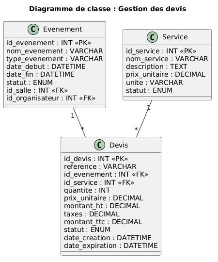

# Module – Devis

## Prérequis

- Node.js 18+
- Base de donnée MySQL
- Une connexion à la base de donnée (`db.js`)
- Tables `devis`, `evenements`, `services` et `evenement_services` existantes
- Un fichier `.env` contenant : `PORT`, `DB_HOST`, `DB_USER`, `DB_PASSWORD`, `DB_NAME`
- Authentification active avec `userAuth`
- Gestion des rôles avec `allowRoles`

## Diagramme de classe pour ce module



---

## Description

Gestion des devis liés aux demandes de services validées.

Ce module permet au coordonnateur ou à l’administrateur de créer un devis pour un service demandé par un organisateur.  
Un devis doit être basé sur une demande de service déjà validée.

---

## API – Routes Devis

### 1. Obtenir tous les devis

**GET** `/api/devis`

Retourne la liste des devis avec les informations de l’événement et du service.

#### Réponse (200)

```json
[
  {
    "id_devis": 1,
    "id_evenement": 1,
    "id_service": 2,
    "reference": "DEV-1-2-1760000000000",
    "montant_ht": 500.00,
    "taxes": 74.88,
    "montant_ttc": 574.88,
    "statut": "Brouillon",
    "date_creation": "2026-02-15T14:00:00.000Z"
  }
]
```

**500 – Erreur serveur**

```json
{ "message": "Erreur serveur" }
```

---

### 2. Obtenir un devis par ID

**GET** `/api/devis/:id`

Retourne un devis spécifique ou `404` si introuvable.

#### Réponse (200)

```json
{
  "id_devis": 1,
  "id_evenement": 1,
  "id_service": 2,
  "reference": "DEV-1-2-1760000000000",
  "montant_ht": 500.00,
  "taxes": 74.88,
  "montant_ttc": 574.88,
  "statut": "Brouillon"
}
```

---

### 3. Créer un devis

**POST** `/api/devis`

Accessible aux rôles :

- Administrateur
- Coordonnateur

Body (JSON) :

```json
{
  "id_evenement": 1,
  "id_service": 2
}
```

Le système vérifie que la demande de service est validée avant de créer le devis.

#### Réponse (201)

```json
{
  "message": "Devis créé avec succès",
  "id_devis": 1,
  "reference": "DEV-1-2-1760000000000"
}
```

---

### 4. Modifier le statut d’un devis

**PUT** `/api/devis/:id/statut`

Body (JSON) :

```json
{
  "statut": "Envoyé"
}
```

Statuts possibles :

- `Brouillon`
- `Envoyé`
- `Accepté`
- `Refusé`

#### Réponse (200)

```json
{
  "message": "Statut du devis mis à jour avec succès"
}
```

---

### 5. Supprimer un devis

**DELETE** `/api/devis/:id`

Supprime un devis.

Réponses :

- `200` : `{ "message": "Devis supprimé" }`
- `404` : `{ "message": "Devis introuvable" }`

---

## Exemple (JS)

```js
import {
  getDevis,
  createDevis,
  updateStatutDevis
} from "../modele/devis.js";

const devis = await getDevis();
console.log(devis);

const nouveauDevis = await createDevis({
  id_evenement: 1,
  id_service: 2
});

await updateStatutDevis(nouveauDevis.id_devis, "Envoyé");
```
