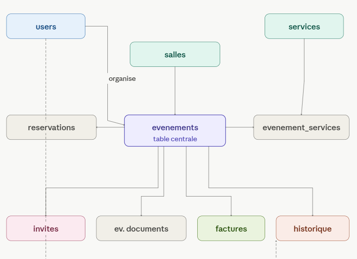

# Module Événements (`evenement.js`)

## Prérequis

- Node.js 18+
- Connexion MySQL via `db/db.js`
- Tables en base : `evenements`, `reservations`, `evenement_services`, `salles`, `services`, `historique_modifications`

## Diagramme (schéma)



---

## Description

Ce module gère la création d'événements, la création automatique des réservations associées et l'association des services demandés.

Il contient notamment :

- Détection de conflits de réservation.
- Création d'un événement dans une transaction (événement + réservation + associations de services).

---

## Routes API liées

> Les routes sont exposées via le serveur principal (voir `server.js`).

### POST /api/evenements

Crée un événement (et réserve la salle). Body (JSON) :

```json
{
  "nom_evenement": "Conférence Node",
  "type_evenement": "Conférence",
  "description": "Journée dev",
  "date_debut": "2026-03-01 09:00:00",
  "date_fin": "2026-03-01 17:00:00",
  "statut": "Prévu", // ou omettre ce champ
  "id_salle": 2,
  "id_organisateur": 1,
  "services": [1, 3]
}
```

#### Ajouter des services à un événement

Le champ `services` est un tableau d'identifiants de services à associer à l'événement. Lors de la création, chaque service sera lié à l'événement avec le statut "Demande".

---

### Upload de documents liés à un événement

**POST** `/api/evenements/:id/documents`

Permet d'uploader un fichier/document lié à un événement. Utilise un formulaire `multipart/form-data` avec le champ `file`.

Réponse (200) :

```json
{
  "message": "Upload réussi"
}
```

Pour obtenir la liste des documents d'un événement :

**GET** `/api/evenements/:id/documents`

Réponse :

```json
[
  {
    "id": 1,
    "id_evenement": 42,
    "nom_fichier": "programme.pdf",
    "chemin_fichier": "uploads/42/programme.pdf",
    "type_mime": "application/pdf",
    "taille": 123456
  }
]
}
```

> **Note** : Le champ `statut` est optionnel, et sera toujours `"Prévu"` à la création (même si "Brouillon" est envoyé).

#### Migration des anciens événements

Pour convertir tous les événements existants de "Brouillon" à "Prévu" :

```sql
UPDATE evenements SET statut = 'Prévu' WHERE statut = 'Brouillon';
```

#### Réponses

**201 – Créé**

```json
{
  "id_evenement": 42
}
```

**409 – Conflit**

```json
{
  "error": "Conflit : salle déjà réservée pour ce créneau"
}
```

**400/500 – Erreur**

```json
{
  "error": "message"
}
```

---

### 2. Obtenir tous les événements

**GET** `/api/evenements`

#### Réponse (200)

```json
[
  {
    "id_evenement": 1,
    "nom_evenement": "Réunion Q1",
    "type_evenement": "Réunion",
    "description": "Réunion trimestrielle",
    "date_debut": "2026-02-20T10:00:00",
    "date_fin": "2026-02-20T12:00:00",
    "statut": "Confirmé",
    "id_salle": 1,
    "id_organisateur": 2
  }
]
```

**500 – Erreur serveur**

```json
{
  "error": "Erreur serveur"
}
```

---

### 3. Obtenir un événement par ID

**GET** `/api/evenements/:id`

Retourne l'événement ou `404` si introuvable.

---

## Exemple d'utilisation (JS)

```js
import { createEvenement } from "../model/evenement.js";

try {
  const id = await createEvenement({
    /* ... */
  });
  console.log("ID événement créé:", id);
} catch (err) {
  if (err.message === "RESERVATION_CONFLICT")
    console.error("Conflit de réservation");
  else console.error(err);
}
```

    ---

### 4. Modifier un événement

**PUT** `/api/evenements/:id`

Permet de modifier un événement existant, ainsi que sa réservation et ses services associés.

#### Body (JSON)

```json
{
  "nom_evenement": "Conférence Node JS",
  "type_evenement": "Conférence",
  "description": "Conférence mise à jour",
  "date_debut": "2026-03-01 10:00:00",
  "date_fin": "2026-03-01 18:00:00",
  "statut": "Confirmé",
  "id_salle": 2,
  "services": [1, 2]
}
```

#### Réponses

**200 – Succès**

```json
{
  "message": "Événement modifié avec succès"
}
```

**404 – Introuvable**

```json
{
  "message": "Événement introuvable"
}
```

**409 – Conflit**

```json
{
  "message": "Conflit de réservation pour la salle et la période choisies."
}
```

**500 – Erreur serveur**

```json
{
  "message": "Erreur serveur"
}
```

---

### 5. Annuler un événement

**PUT** `/api/evenements/:id/annuler`

Permet d'annuler un événement (statut = "Annulé").

#### Réponse (200)

```json
{
  "message": "Événement annulé avec succès"
}
```

**404 – Introuvable**

```json
{
  "message": "Événement introuvable"
}
```

**500 – Erreur serveur**

```json
{
  "message": "Erreur serveur"
}
```

---

### 6. Confirmer un événement

**PUT** `/api/evenements/:id/confirmer`

Confirme un événement (statut = `"Confirmé"`). Vérifie que toutes les demandes de services sont validées avant de confirmer. Génère ou met à jour la facture automatiquement.

#### Réponses

**200 – Succès**

```json
{
  "message": "Événement confirmé avec succès"
}
```

**400 – Services en attente**

```json
{
  "message": "Impossible de confirmer : certaines demandes sont encore en attente"
}
```

**400 – Déjà confirmé ou annulé**

```json
{
  "message": "Événement déjà confirmé"
}
```

**404 – Introuvable**

```json
{
  "message": "Événement introuvable"
}
```

---

### 7. Restaurer un événement annulé

**PUT** `/api/evenements/:id/restaurer`

Remet un événement annulé au statut `"Prévu"`. Seuls les événements dont le statut est `"Annulé"` peuvent être restaurés.

#### Réponses

**200 – Succès**

```json
{
  "message": "Événement restauré"
}
```

**400 – Statut invalide**

```json
{
  "message": "Seuls les événements annulés peuvent être restaurés"
}
```

**404 – Introuvable**

```json
{
  "message": "Événement introuvable"
}
```

---

### 8. Passage automatique à "Terminé"

**POST** `/api/evenements/terminer-expires`

Passe automatiquement au statut `"Terminé"` tous les événements dont la `date_fin` est dépassée et dont le statut n'est ni `"Annulé"` ni `"Terminé"`. Cette route est appelée par le frontend à chaque chargement de la liste des événements.

#### Réponse (200)

```json
{
  "updated": 3
}
```

> Le champ `updated` indique le nombre d'événements mis à jour.

---

### 9. Historique des modifications d'un événement

**GET** `/api/evenements/:id/historique`

Retourne le journal de toutes les modifications apportées à un événement (champ modifié, ancienne valeur, nouvelle valeur, date, utilisateur).

#### Réponse (200)

```json
[
  {
    "id": 1,
    "champ_modifie": "nom_evenement",
    "ancienne_valeur": "Réunion Q1",
    "nouvelle_valeur": "Réunion Q1 – mise à jour",
    "date_modification": "2026-04-10T14:32:00",
    "nom": "Sagno",
    "prenom": "Véronique"
  }
]
```

> L'historique est enregistré automatiquement à chaque appel `PUT /api/evenements/:id` pour chaque champ dont la valeur a changé.

---

### 10. Historique général (tous les événements)

**GET** `/api/historique`

Retourne la liste complète des événements avec leurs informations enrichies (salle, organisateur, participants, budget). Supporte des filtres en query string.

#### Paramètres (optionnels)

| Paramètre    | Type   | Description                           |
| ------------ | ------ | ------------------------------------- |
| `date_debut` | string | Début de la période (avec `date_fin`) |
| `date_fin`   | string | Fin de la période (avec `date_debut`) |
| `statut`     | string | Filtrer par statut                    |
| `id_salle`   | number | Filtrer par salle                     |

#### Réponse (200)

```json
[
  {
    "id_evenement": 1,
    "nom_evenement": "Gala 2026",
    "type_evenement": "Gala",
    "date_debut": "2026-04-30T08:00:00",
    "date_fin": "2026-04-30T22:00:00",
    "statut": "Confirmé",
    "nb_participants": 120,
    "budget": 15000.0,
    "nom_salle": "Grande salle",
    "organisateur_nom": "Sagno",
    "organisateur_prenom": "Véronique"
  }
]
```

---

## Fonctions du modèle (`evenement.js`)

| Fonction                                                     | Description                                                                            |
| ------------------------------------------------------------ | -------------------------------------------------------------------------------------- |
| `hasReservationConflict(id_salle, date_debut, date_fin)`     | Vérifie s'il y a un conflit de réservation                                             |
| `createEvenement(data)`                                      | Crée un événement + réservation + services dans une transaction                        |
| `getAllFromEvenements()`                                     | Récupère tous les événements (requête simple)                                          |
| `getAllFromEvenements()`                                     | Récupère tous les événements avec auto-update "Terminé" + jointures salle/organisateur |
| `getEvenementById(id)`                                       | Récupère un événement par ID                                                           |
| `getEvenementInfoForNotification(id)`                        | Récupère les infos nécessaires aux notifications (organisateur, email)                 |
| `getEvenementServiceInfoForNotification(id_ev, id_svc)`      | Idem + nom du service                                                                  |
| `logModification(id_ev, id_user, champ, ancienne, nouvelle)` | Enregistre une modification dans `historique_modifications`                            |
| `getHistoriqueEvenement(id_evenement)`                       | Retourne le journal de modifications d'un événement                                    |

---

## Table `historique_modifications`

```sql
CREATE TABLE IF NOT EXISTS historique_modifications (
  id                INT AUTO_INCREMENT PRIMARY KEY,
  id_evenement      INT NOT NULL,
  id_user           INT NOT NULL,
  champ_modifie     VARCHAR(100) NOT NULL,
  ancienne_valeur   TEXT DEFAULT NULL,
  nouvelle_valeur   TEXT DEFAULT NULL,
  date_modification DATETIME DEFAULT NOW(),
  CONSTRAINT fk_histo_evenement FOREIGN KEY (id_evenement)
    REFERENCES evenements (id_evenement) ON DELETE CASCADE,
  CONSTRAINT fk_histo_user FOREIGN KEY (id_user)
    REFERENCES users (id_user)
);
```
