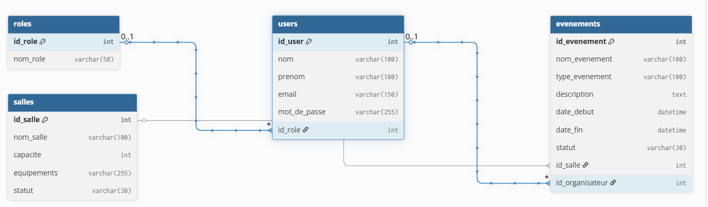

# Module Événements (`evenement.js`)

## Prérequis

- Node.js 18+
- Connexion MySQL via `db/db.js`
- Tables en base : `evenements`, `reservations`, `evenement_services`, `salles`, `services`

## Diagramme (schéma)



---

## Description

Ce module gère la création d'événements, la création automatique des réservations associées et l'association des services demandés.

Il contient notamment :

- Détection de conflits de réservation.
- Création d'un événement dans une transaction (événement + réservation + associations de services).

---

## Routes API liées

> Les routes sont exposées via le serveur principal (voir `server.js`).

### POST /api/evenements

Crée un événement (et réserve la salle). Body (JSON) :

```json
  {
    "nom_evenement": "Conférence Node",
    "type_evenement": "Conférence",
    "description": "Journée dev",
    "date_debut": "2026-03-01 09:00:00",
    "date_fin": "2026-03-01 17:00:00",
    "statut": "Brouillon",
    "id_salle": 2,
    "id_organisateur": 1,
    "services": [1,3]
  }
  ```

  #### Réponses

  **201 – Créé**

  ```json
  {
    "id_evenement": 42
  }
  ```

  **409 – Conflit**

  ```json
  {
    "error": "Conflit : salle déjà réservée pour ce créneau"
  }
  ```

  **400/500 – Erreur**

  ```json
  {
    "error": "message"
  }
  ```

  ---

  ### 2. Obtenir tous les événements

  **GET** `/api/evenements`

  #### Réponse (200)

  ```json
  [
    {
      "id_evenement": 1,
      "nom_evenement": "Réunion Q1",
      "type_evenement": "Réunion",
      "description": "Réunion trimestrielle",
      "date_debut": "2026-02-20T10:00:00",
      "date_fin": "2026-02-20T12:00:00",
      "statut": "Confirmé",
      "id_salle": 1,
      "id_organisateur": 2
    }
  ]
  ```

  **500 – Erreur serveur**

  ```json
  {
    "error": "Erreur serveur"
  }
  ```

  ---

  ### 3. Obtenir un événement par ID

  **GET** `/api/evenements/:id`

  Retourne l'événement ou `404` si introuvable.

  ---

  ## Exemple d'utilisation (JS)

  ```js
  import { createEvenement } from '../model/evenement.js'

  try {
    const id = await createEvenement({ /* ... */ })
    console.log('ID événement créé:', id)
  } catch (err) {
    if (err.message === 'RESERVATION_CONFLICT') console.error('Conflit de réservation')
    else console.error(err)
  }
  ```

