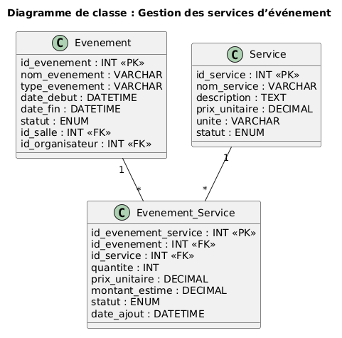

# Module – Événement Services

## Prérequis

- Node.js 18+
- Base de donnée MySQL
- Une connexion à la base de donnée (`db.js`)
- Tables `evenement_services`, `evenements` et `services` existantes
- Un fichier `.env` contenant : `PORT`, `DB_HOST`, `DB_USER`, `DB_PASSWORD`, `DB_NAME`
- Authentification active avec `userAuth`
- Gestion des rôles avec `allowRoles`

## Diagramme de classe pour ce module



---

## Description

Gestion des demandes de services liées aux événements.

Ce module permet à un organisateur de créer ou modifier des besoins pour un événement, comme la restauration ou l’audiovisuel.  
Il permet aussi au coordonnateur ou à l’administrateur de valider ou refuser une demande de service.

---

## API – Routes Événement Services

### 1. Obtenir toutes les demandes de services

**GET** `/api/evenementservices`

Retourne la liste des demandes de services avec les informations de l’événement et du service.

#### Réponse (200)

```json
[
  {
    "id_evenement": 1,
    "id_service": 2,
    "nom_evenement": "Réunion Projet Alpha",
    "nom_service": "Restauration",
    "details": "Pause café pour 20 personnes",
    "quantite": 20,
    "montant_estime": 250.00,
    "statut": "Demande",
    "date_demande": "2026-02-15T14:00:00.000Z"
  }
]
```

**500 – Erreur serveur**

```json
{ "message": "Erreur serveur" }
```

---

### 2. Créer une demande de service

**POST** `/api/evenementservices`

Accessible aux rôles :

- Administrateur
- Organisateur

Body (JSON) :

```json
{
  "id_evenement": 1,
  "id_service": 2,
  "details": "Besoin d'un buffet pour 30 personnes",
  "quantite": 30,
  "montant_estime": 500.00
}
```

#### Réponse (201)

```json
{
  "message": "Demande de service créée avec succès"
}
```

---

### 3. Modifier une demande de service

**PUT** `/api/evenementservices/:id_evenement/:id_service`

Permet de modifier les détails, la quantité ou le montant estimé d’une demande.

Body (JSON) :

```json
{
  "details": "Besoin de micros et projecteur",
  "quantite": 2,
  "montant_estime": 150.00
}
```

#### Réponse (200)

```json
{
  "message": "Demande de service modifiée avec succès"
}
```

---

### 4. Modifier le statut d’une demande

**PUT** `/api/evenementservices/:id_evenement/:id_service/statut`

Accessible aux rôles :

- Administrateur
- Coordonnateur

Body (JSON) :

```json
{
  "statut": "Valide"
}
```

Statuts acceptés :

- `Demande`
- `Valide`
- `Refuse`

#### Réponse (200)

```json
{
  "message": "Statut de la demande mis à jour avec succès"
}
```

---

### 5. Supprimer une demande de service

**DELETE** `/api/evenementservices/:id_evenement/:id_service`

Supprime une demande de service liée à un événement.

Réponses :

- `200` : `{ "message": "Demande de service supprimée" }`
- `404` : `{ "message": "Demande de service introuvable" }`

---

## Exemple (JS)

```js
import {
  getEvenementServices,
  createEvenementService,
  updateStatutEvenementService
} from "../modele/evenementService.js";

const demandes = await getEvenementServices();
console.log(demandes);

await createEvenementService({
  id_evenement: 1,
  id_service: 2,
  details: "Buffet pour 30 personnes",
  quantite: 30,
  montant_estime: 500
});

await updateStatutEvenementService(1, 2, "Valide");
```
