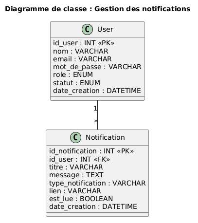

# Module – Notifications

## Prérequis

- Node.js 18+
- Base de donnée MySQL
- Une connexion à la base de donnée (`db.js`)
- Table `notifications` existante
- Table `users` existante
- Un fichier `.env` contenant : `PORT`, `DB_HOST`, `DB_USER`, `DB_PASSWORD`, `DB_NAME`
- Authentification active avec `userAuth`
- Gestion des rôles avec `allowRoles`

## Diagramme de classe pour ce module



---

## Description

Gestion des notifications internes de l’application.

Ce module permet d’envoyer des notifications aux utilisateurs selon les actions importantes du système :

- création d’un événement
- validation ou refus d’une demande de service
- création d’un devis
- annulation ou confirmation d’un événement

Exemple : lorsqu’un organisateur crée un événement, les administrateurs reçoivent une notification.

---

## API – Routes Notifications

### 1. Obtenir mes notifications

**GET** `/api/notifications`

Retourne les notifications de l’utilisateur connecté.

#### Réponse (200)

```json
[
  {
    "id_notification": 1,
    "id_user": 3,
    "titre": "Nouvel événement créé",
    "message": "L'organisateur Kevin Linou a créé l'événement Réunion Projet Alpha.",
    "type_notification": "evenement",
    "lien": "/admin/evenements",
    "est_lue": 0,
    "date_creation": "2026-02-15T14:00:00.000Z"
  }
]
```

**500 – Erreur serveur**

```json
{ "message": "Erreur serveur" }
```

---

### 2. Créer une notification

**POST** `/api/notifications`

Body (JSON) :

```json
{
  "id_user": 3,
  "titre": "Nouvelle notification",
  "message": "Vous avez une nouvelle action à consulter.",
  "type_notification": "info",
  "lien": "/dashboard"
}
```

#### Réponse (201)

```json
{
  "message": "Notification créée avec succès",
  "id_notification": 1
}
```

---

### 3. Marquer une notification comme lue

**PUT** `/api/notifications/:id/lue`

Marque une notification de l’utilisateur connecté comme lue.

#### Réponse (200)

```json
{
  "message": "Notification marquée comme lue"
}
```

---

### 4. Marquer toutes mes notifications comme lues

**PUT** `/api/notifications/lues`

Marque toutes les notifications de l’utilisateur connecté comme lues.

#### Réponse (200)

```json
{
  "message": "Toutes les notifications ont été marquées comme lues"
}
```

---

### 5. Supprimer une notification

**DELETE** `/api/notifications/:id`

Supprime une notification de l’utilisateur connecté.

Réponses :

- `200` : `{ "message": "Notification supprimée" }`
- `404` : `{ "message": "Notification introuvable" }`

---

## Exemple (JS)

```js
import {
  createNotification,
  notifyAdmins,
  getNotificationsByUser
} from "../modele/notification.js";

await notifyAdmins({
  titre: "Nouvel événement créé",
  message: "Un organisateur a créé un nouvel événement.",
  type_notification: "evenement",
  lien: "/admin/evenements"
});

const notifications = await getNotificationsByUser(3);
console.log(notifications);
```
