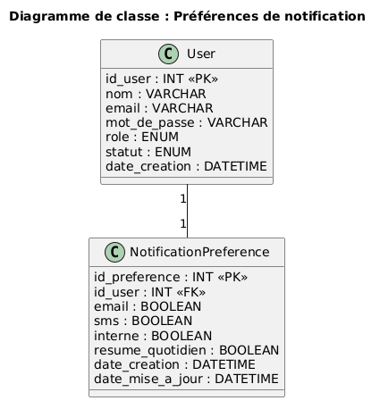

# Module – Préférences de notifications

## Prérequis

- Node.js 18+
- Base de donnée MySQL
- Une connexion à la base de donnée (`db.js`)
- Table `notification_preferences` existante
- Table `users` existante
- Un fichier `.env` contenant : `PORT`, `DB_HOST`, `DB_USER`, `DB_PASSWORD`, `DB_NAME`
- Authentification active avec `userAuth`

## Diagramme de classe pour ce module



---

## Description

Gestion des préférences de notifications des utilisateurs.

Ce module permet à chaque utilisateur de choisir les canaux par lesquels il souhaite recevoir ses notifications :

- notification interne
- email
- SMS

Les préférences sont personnelles et ne dépendent pas directement du rôle.  
Chaque utilisateur peut donc activer ou désactiver ses propres canaux.

---

## API – Routes Préférences de notifications

### 1. Obtenir mes préférences

**GET** `/api/notificationpreferences`

Retourne les préférences de notification de l’utilisateur connecté.

#### Réponse (200)

```json
{
  "id_preference": 1,
  "id_user": 3,
  "canal_interne": 1,
  "canal_email": 1,
  "canal_sms": 0,
  "date_modification": "2026-02-15T14:00:00.000Z"
}
```

**500 – Erreur serveur**

```json
{ "message": "Erreur serveur" }
```

---

### 2. Créer mes préférences

**POST** `/api/notificationpreferences`

Crée les préférences de notification pour l’utilisateur connecté.

Body (JSON) :

```json
{
  "canal_interne": true,
  "canal_email": true,
  "canal_sms": false
}
```

#### Réponse (201)

```json
{
  "message": "Préférences créées avec succès"
}
```

---

### 3. Modifier mes préférences

**PUT** `/api/notificationpreferences`

Met à jour les préférences de notification de l’utilisateur connecté.

Body (JSON) :

```json
{
  "canal_interne": true,
  "canal_email": false,
  "canal_sms": false
}
```

#### Réponse (200)

```json
{
  "message": "Préférences mises à jour avec succès"
}
```

---

### 4. Réinitialiser mes préférences

**PUT** `/api/notificationpreferences/reset`

Réinitialise les préférences avec les valeurs par défaut.

Valeurs par défaut :

- notification interne : activée
- email : désactivé
- SMS : désactivé

#### Réponse (200)

```json
{
  "message": "Préférences réinitialisées avec succès"
}
```

---

## Exemple (JS)

```js
import {
  getNotificationPreferencesByUser,
  updateNotificationPreferences
} from "../modele/notificationPreference.js";

const preferences = await getNotificationPreferencesByUser(3);
console.log(preferences);

await updateNotificationPreferences(3, {
  canal_interne: true,
  canal_email: false,
  canal_sms: false
});
```
