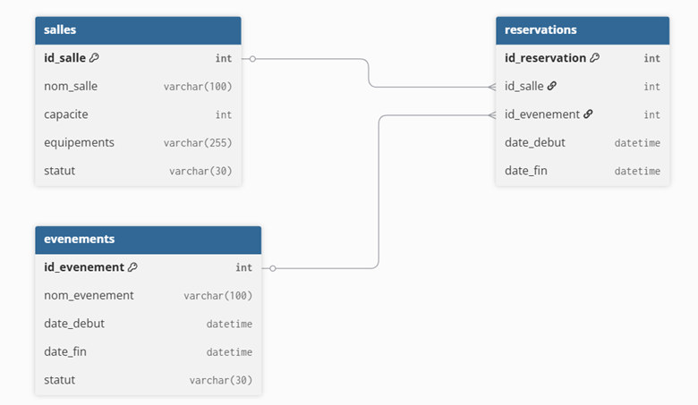

# Module – Salles

## Prérequis

- Node.js 18+
- Base de donnée MySQL
- Une connexion à la base de donnée (`db.js`)
- Table `salles` existante
- Un fichier `.env` contenant : `PORT`, `DB_HOST`, `DB_USER`, `DB_PASSWORD`, `DB_NAME`

## Diagramme de classe pour ce module



---

## Description

Gestion des salles : lecture, création, modification et suppression.

---

## API – Routes Salles

### 1. Obtenir toutes les salles

**GET** `/api/salles`

Retourne la liste de toutes les salles disponibles.

#### Réponse (200)

```json
[
  {
    "id_salle": 1,
    "nom_salle": "Salle Versailles",
    "capacite": 100,
    "equipements": "Projecteur, Micro, Wifi",
    "statut": "Disponible"
  }
]
```

**500 – Erreur serveur**

```json
{ "error": "Erreur serveur" }
```

---

### 2. Obtenir une salle par ID

**GET** `/api/salles/:id`

Retourne une salle spécifique ou `404` si introuvable.

---

### 3. Créer une salle

**POST** `/api/salles`

Body (JSON) :

```json
{
  "nom_salle":"Nom",
  "capacite":50,
  "equipements":"Projecteur",
  "statut":"Disponible"
}
```

#### Réponse (201)

```json
{ "id": 10 }
```

---

### 4. Modifier une salle

**PUT** `/api/salles/:id`

Met à jour les champs de la salle. Réponse 200 ou 404 si introuvable.

---

### 5. Supprimer une salle

**DELETE** `/api/salles/:id`

Réponses :

- `200` : `{ "message": "Salle supprimée" }`
- `404` : `{ "message": "Salle introuvable" }`

---

## Exemple (JS)

```js
import { getSalles, createSalle } from '../model/salle.js'

const salles = await getSalles()
console.log(salles)

const id = await createSalle('Salle A', 50, 'Projecteur, Sono', 'Disponible')
console.log('Nouvelle salle id:', id)
```
