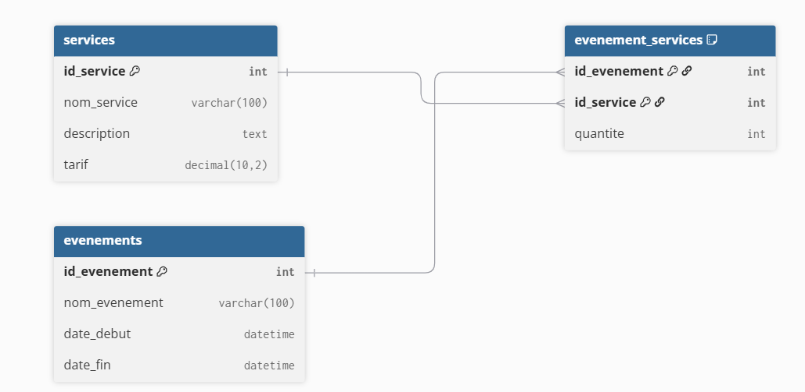

# Module – Services

## Prérequis

- Node.js 18+
- Base de donnée MySQL
- Une connexion à la base de donnée (`db.js`)
- Table `services` existante
- Un fichier `.env` contenant : `PORT`, `DB_HOST`, `DB_USER`, `DB_PASSWORD`, `DB_NAME`

## Diagramme de classe pour ce module



---

## Description

Gestion des services proposés (nom, description, tarif) et endpoints CRUD.

---

## API – Routes Services

### 1. Obtenir tous les services

**GET** `/api/services`

#### Réponse (200)

```json
[
  {
    "id_service": 1,
    "nom_service": "Traiteur",
    "description": "Service traiteur complet",
    "tarif": 500
  }
]
```

**500 – Erreur serveur**

```json
{ "error": "Erreur serveur" }
```

---

### 2. Obtenir un service par ID

**GET** `/api/services/:id`

Retourne un service ou `404`.

---

### 3. Créer un service

**POST** `/api/services`

Body (JSON) :

```json
{
  "nom_service":"Traiteur",
  "description":"Buffet",
  "tarif":500
}
```

#### Réponse (201)

```json
{ "id_service": 7 }
```

---

### 4. Modifier un service

**PUT** `/api/services/:id`

Met à jour le service. Validation : `tarif` doit être un nombre >= 0.

---

### 5. Supprimer un service

**DELETE** `/api/services/:id`

Réponses :

- `200` : `{ "message": "Service supprimé" }`
- `404` : `{ "message": "Service introuvable" }`

---

## Exemple (JS)

```js
import { getServices, createService } from '../model/service.js'

const services = await getServices()
console.log(services)

const id = await createService('Traiteur', 'Service traiteur complet', 500)
console.log('Nouveau service id:', id)
```
